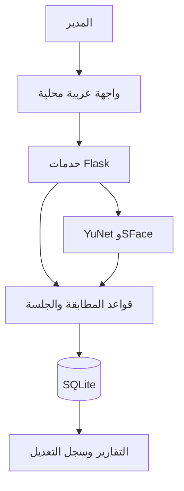
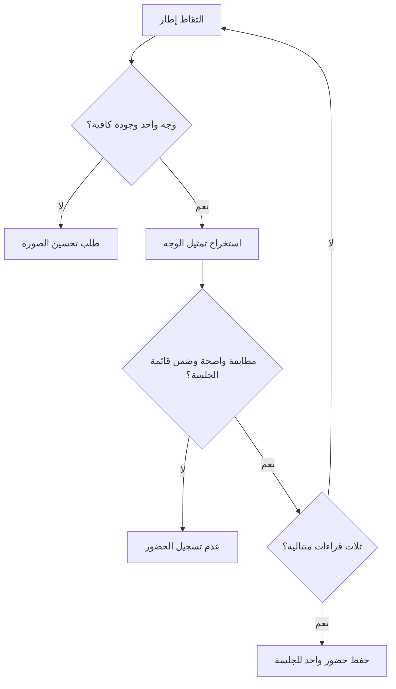
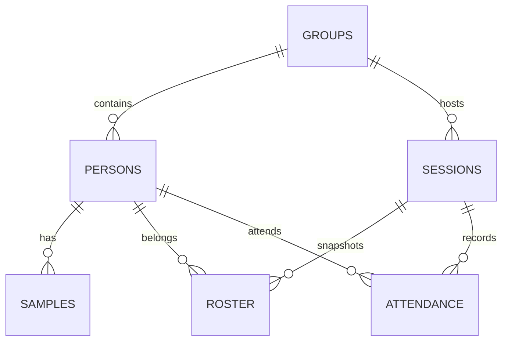

# بصيرة AI — تصور مشروع التخرج

**العنوان المقترح:** تصميم وتنفيذ منظومة محلية لإدارة الحضور باستخدام التعرّف على الوجه وتقنيات التعلم العميق.

## المشكلة والهدف

يستهلك توثيق الحضور اليدوي وقتًا وقد يؤدي إلى تكرار الإدخالات وصعوبة استخراج التقارير. يهدف المشروع إلى التعرف على الأشخاص المسجلين بموافقتهم، وربط المطابقة بجلسة وقائمة أشخاص ومهلة تأخير، مع إبقاء البيانات على الجهاز وتوفير تصحيح يدوي موثق. المستفيدون: مسؤول المعمل أو المحاضر والطلاب المسجلون.

## نطاق التنفيذ الحالي

حساب مدير محلي، مجموعات، أشخاص، ثلاث إلى خمس عينات للوجه، تحديث العينات ومحوها، جلسات بقائمة ثابتة، مطابقة بالكاميرا، تأخير، منع تكرار الحضور، تقارير CSV والطباعة إلى PDF، سجل تدقيق، نسخ SQLite واستعادتها بسكربت مستقل. يعمل على كمبيوتر واحد. تعدد الأجهزة والحسابات والتزامن السحابي وكشف الحيوية وتسجيل الانصراف ليست ضمن هذه النسخة.

## أين الذكاء الاصطناعي؟

1. **YuNet:** شبكة لاكتشاف موقع الوجه وخمس نقاط محاذاة.
2. **SFace:** شبكة لاستخراج تمثيل عددي للوجه بعد محاذاته.
3. تطبيع التمثيل ثم حساب تشابه جيب التمام مع عينات الأشخاص النشطين. تستخدم أفضل عينتين لكل شخص عند توفرهما، ثم يُطبق حد المطابقة وهامش فصل عن أقرب منافس.
4. يتحقق النظام من عضوية الشخص في الجلسة، ويطلب ثلاث قراءات مستقرة، ثم يحفظ الحضور في معاملة SQLite.

النماذج مدرّبة مسبقًا؛ مساهمة الطالب هي تصميم المنظومة ودمج الذكاء الاصطناعي وتقييم القرار وضمان سلامة قواعد الحضور. لا يصح وصف المشروع بأنه ابتكار نموذج جديد دون بحث وتدريب إضافيين.

## البنية

واجهة HTML/CSS/JavaScript عربية ← API محلية باستخدام Flask ← خدمات الرؤية وقواعد الحضور ← SQLite. لا اتصالات سحابية أثناء الاستخدام ولا CDN. يرسل المتصفح إطارات JPEG محليًا فقط بعد تشغيل المستخدم للكاميرا.



## حالات الاستخدام

المدير ينشئ المجموعات، يسجّل بيانات الأشخاص بموافقتهم، يحدّث أو يمحو قوالبهم، يفتح جلسة ويشغّل الكاميرا ويغلق الجلسة ويستخرج التقارير. يقف الشخص المسجّل أمام الكاميرا. يتخذ النظام قرار المطابقة ويمنع التسجيل المكرر. يمكن للمدير إجراء تصحيح موثّق.



## قاعدة البيانات

| الجدول | الغرض |
|---|---|
| admins | كلمة مرور مجزأة لحساب المدير |
| groups | المجموعات |
| persons | الاسم والرقم والمجموعة والحالة وتاريخ الموافقة |
| samples | قوالب الوجه العددية، بعلاقة متعدد إلى شخص |
| sessions | عنوان الجلسة والبداية ومهلة التأخير والإغلاق |
| roster | قائمة الأشخاص الثابتة لكل جلسة |
| attendance | تسجيل واحد للشخص والجلسة، وطريقته ووقته ودرجة المطابقة |
| audit | أثر الإجراءات والتصحيحات |
| settings | معيار المطابقة |



## خطة التقييم الأكاديمي

اجمع بيانات بموافقة أصحابها، وافصل صور التسجيل عن صور الاختبار وبيانات ضبط العتبة. اختبر درجات إضاءة وزوايا ومسافات مختلفة. أدرج أشخاصًا غير مسجلين لقياس القبول الخاطئ. لا تضع نتائج أو نسب دقة افتراضية.

| القياس | ما يوضحه |
|---|---|
| القبول الخاطئ FAR | عدد الأزواج المختلفة المقبولة / جميع الأزواج المختلفة المعالجة |
| الرفض الخاطئ FRR | عدد الأزواج المتطابقة المرفوضة / جميع الأزواج المتطابقة المعالجة |
| فشل المعالجة | الحالات التي لم يمكن استخراج وجه منها؛ تُعرض منفصلة |
| زمن المعالجة | المتوسط لكل صورة على الجهاز المستخدم، مع ذكر مواصفاته |
| تقييم التعرف 1:N | قبول هوية صحيحة، هوية خاطئة، رفض شخص معروف، ورفض شخص غير مسجل |
| تقييم النظام | تكرار الحضور، الإغلاق، التزامن، التأخير، وفقد الاتصال بالكاميرا |

أداة `scripts/evaluate_pairs.py` تقيس **التحقق 1:1 فقط** على CSV بعمود `file_a,file_b,same`؛ لا تستبدل تقييم التعرف 1:N أو اختبار الحضور الكامل. مثال ملف تنشئه من بياناتك:

```csv
file_a,file_b,same
images/student01_enroll.jpg,images/student01_test.jpg,1
images/student01_enroll.jpg,images/student02_test.jpg,0
```

```powershell
& '.\.venv\Scripts\python.exe' '.\scripts\evaluate_pairs.py' '.\pairs.csv' --threshold 0.50 --output '.\evaluation.json'
```

جرّب قيم العتبة على بيانات التطوير أولًا، ثم قيّم القيمة المختارة على مجموعة اختبار مستقلة. الدقة الظاهرة في توثيق النموذج على مجموعات بحثية لا تمثل دقة منظومتك أو جهازك. الحماية من الانتحال بالصور تحتاج عملًا منفصلًا واختبارًا فعليًا.

## متطلبات غير وظيفية

حفظ دائم في SQLite مع قيود فريدة وعلاقات أجنبية، معالجة محلية، كلمة مرور مجزأة، جلسة HttpOnly/SameSite مع حماية CSRF، رفض أسماء المضيف الخارجية، معالجة مؤجلة للكاميرا عند طلب المستخدم، واجهة عربية قابلة للطباعة. لا تُشفّر قاعدة البيانات في هذه النسخة ولا يوجد ادعاء بحماية كاملة للجهاز.

## فصول التقرير المقترحة

المقدمة والمشكلة؛ الدراسات السابقة والتعرّف على الوجه؛ تحليل المتطلبات وحالات الاستخدام؛ تصميم البنية وقاعدة البيانات؛ التنفيذ والتقنيات؛ الاختبارات والنتائج الفعلية؛ الخاتمة والقيود والتطوير المستقبلي. يمكن إرفاق مخططات Mermaid أو إعادة رسمها في أداة الجامعة.

## مصادر أصلية

- https://docs.opencv.org/4.x/d0/dd4/tutorial_dnn_face.html
- https://github.com/opencv/opencv_zoo/tree/main/models/face_detection_yunet
- https://github.com/opencv/opencv_zoo/tree/main/models/face_recognition_sface
- https://huggingface.co/opencv/face_detection_yunet
- https://huggingface.co/opencv/face_recognition_sface
- https://flask.palletsprojects.com/

تتضمن manifest.json أسماء النماذج وبصماتها ومصادرها، ويجلب الإعداد تراخيصها عند التنزيل.
